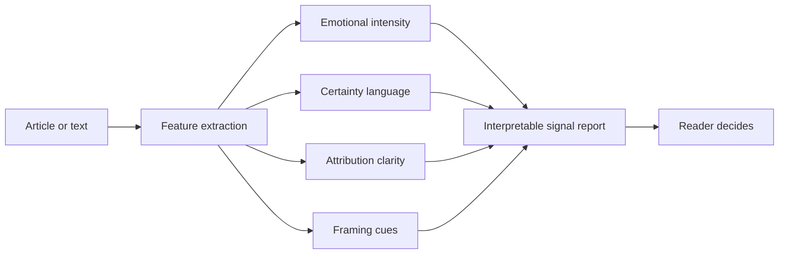

# 👁️ Videre Labs: Contextual Misinformation Detection

**An interpretable approach to misleading media: instead of labelling content true or false, Videre Labs surfaces the persuasion techniques inside a piece of writing so readers can judge it for themselves.**

 

## The problem

Most misinformation tools give a verdict: true or false. That breaks down in the places young people actually get their news, where irony, memes and performative absurdity are everywhere and a binary label is often wrong or simply ignored.

Videre Labs takes a more cautious approach, designed around what NLP can and can't reliably do. It doesn't tell you what to believe. It shows you **how a piece of text is trying to make you feel and think**, and leaves the judgement to you.

## How it works

The system analyses text across four research-backed rhetorical signals:

| Signal | What it looks for |
|---|---|
| **Emotional intensity** | Language designed to provoke strong, high-arousal reactions |
| **Certainty language** | Claims stated as absolute fact, with no hedging or uncertainty |
| **Attribution clarity** | Whether claims are tied to named, checkable sources, or to "experts say" |
| **Framing cues** | Whether the text presents one dominant narrative or several perspectives |

Each signal is reported separately rather than collapsed into one score, so a reader can see exactly *why* a text was flagged.

## What I built

- A prototype feature-extraction pipeline for the four signals
- A simulation-based evaluation of whether surfacing these signals reduces impulsive sharing
- Iterative refinement of the thresholds for each signal, tested against real-world media

## Where it led

Feedback from testing showed that fact-checkers needed help deciding *which* claims to check first. That became my next project, **[Misinformation Monitor](https://github.com/itzwasiqsalman-cloud/misinformation-monitor)**, which carries these same four signals into a live claim-tracking pipeline.

## Read more

- [Seeing Before Believing: Measuring Persuasive Architecture in Modern Media](https://medium.com/@itzwasiq.salman/seeing-before-believing-measuring-persuasive-architecture-in-modern-media-aa41f3164a6b): how the model was built, refined and validated
- [How AI Spots Deepfakes by Reading the Digital Fingerprints We Can't See](https://medium.com/@itzwasiq.salman/how-ai-spots-deepfakes-by-reading-the-digital-fingerprints-we-cant-see-98ef297a8596)

## Tech

JavaScript · HTML · NLP · reader psychology research

---

Built by [Muhammad Wasiq Salman](https://github.com/itzwasiqsalman-cloud) as part of The Knowledge Society (TKS). This repository documents the project's design and findings; it is complete and no longer maintained.
